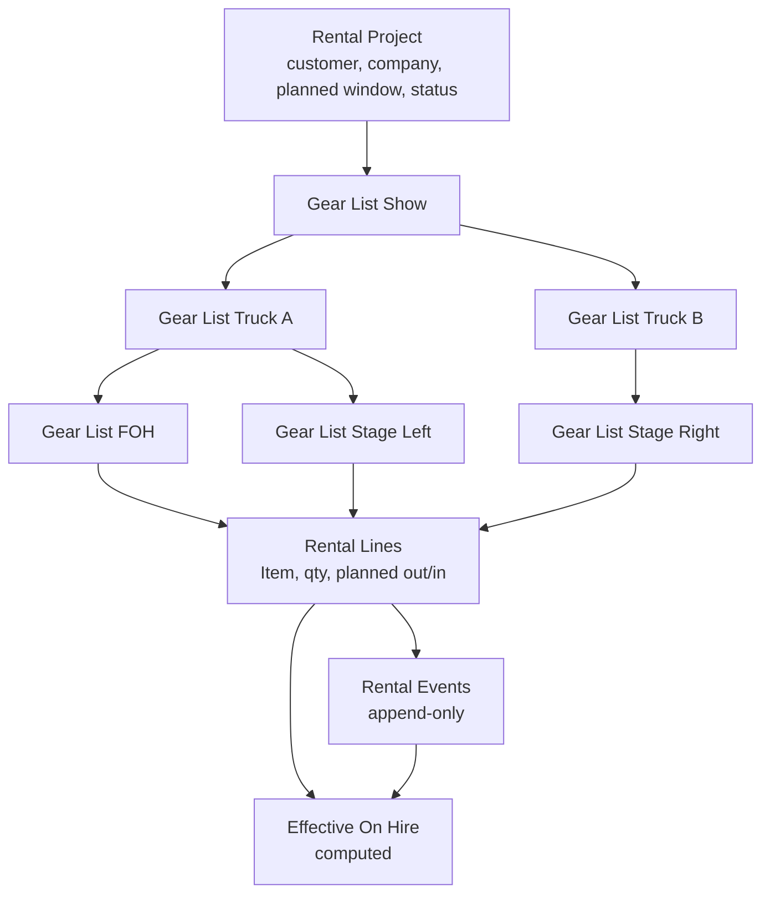
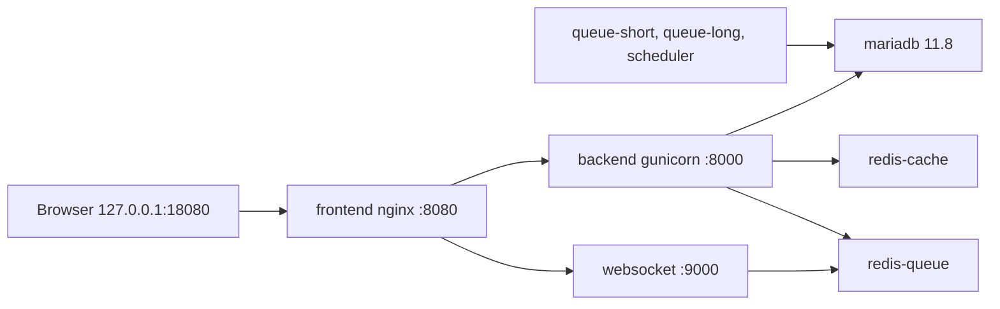

# Architecture

`av_rental` is a Frappe app on ERPNext. ERPNext stays upstream. The app does not encode a nested hire as one editable Sales Order.

## Documents

| DocType | Role |
|---|---|
| Rental Project | Stable job identity: customer, company, planned start/end, an explicit project status. |
| Gear List | Named tree node. `parent_gear_list` is optional, so a job can be one flat list or a list of lists (Show / Truck A / FOH). |
| Rental Line | Item, planned qty, warehouse, optional serial numbers, and the line's own planned out/in. Reuses ERPNext Item, UOM, and Warehouse. |
| Rental Event | Append-only Issue, Partial Return, Extend, or Damage. Stores qty, timestamp, reason, actor, and a batch id when several lines were changed together. |
| Effective On Hire | Not stored. Script report plus `av_rental.api.effective_on_hire`. |

Planned dates and planned qty are the baseline. Once a line, list, or project has events, those planned fields are locked. An extension stores `extended_until` on the event. The effective expected return is the latest extension, otherwise the planned return.

List status (`Planned`, `Issued`, `Partially Returned`, `Returned`) is a cache derived from events. An action refreshes the gear list it targeted and that list's descendants. Ancestors such as Show, and siblings such as Truck B, are not saved.

Damage records an incident against issued quantity. It does not reduce on-hire. On-hire is issued minus partial returns.

Events cannot be edited or deleted. The controller rejects updates and deletes, and the System Manager permission does not grant write or delete. That is deliberate: a cancelled or amended document would rewrite the trail.

## What one action is allowed to touch

Issuing, returning, extending, or recording damage on Truck A:

- inserts one Rental Event per affected line under Truck A, FOH, and Stage Left
- refreshes list status for that subtree only
- leaves Truck B, Stage Right, Show, the project, and every line's planned window unsaved

The pure version of this rule is `av_rental.domain` and `av_rental.festival`. `python3 -m unittest discover -s apps/av_rental/tests -v` runs it with no site. `av_rental.demo.run` performs the same story through the whitelisted API and checks the database.

Desk buttons are Client Scripts copied from `av_rental/public/js` on install and migrate, so they work on the production image without a separate asset build. The same whitelisted methods serve the buttons and the demo.

## Compose topology

`compose.yaml` is a single-file merge of the current [frappe_docker](https://github.com/frappe/frappe_docker) `compose.yaml` plus the MariaDB, Redis, and no-proxy overrides. Image pins at the time of writing:

| Image | Tag | Role |
|---|---|---|
| Built locally as `avrental-erpnext` | `v16.54.0` | `FROM frappe/erpnext:v16.54.0`, then `pip install -e apps/av_rental` |
| `mariadb` | `11.8` | Same major as the upstream override. No host port. |
| `redis` | `8.6-alpine` | Cache (no volume) and queue (append-only volume). No host port. |

The configurator runs once, writes `sites/apps.txt` from the apps directory (so `av_rental` is included), and points the bench at `db`, `redis-cache`, and `redis-queue`. Site creation is a second step (`scripts/create-site.sh`) because upstream frappe_docker does not create a site inside `up`.

Host port **18080** is bound on **127.0.0.1** only. Container nginx still listens on **8080**. `FRAPPE_SITE_NAME_HEADER` defaults to `avrental.localhost`, which is also the site name, so `http://127.0.0.1:18080` resolves without a hosts-file entry.

MariaDB and Redis are not published. The root password is `DB_PASSWORD` from `.env`, falling back to the local placeholder `change-me`. The first database initialisation stores that password; changing `.env` later does not rotate it.

Workers and the scheduler are part of the default stack so background jobs match a normal frappe_docker bench. The demo itself is synchronous. On a small machine, `docker compose stop queue-short queue-long scheduler` frees memory without affecting the desk actions.

## Out of scope

Crew scheduling, transport routing, a client portal, barcode hardware, RFID, and automated invoicing. Serial numbers can be recorded on a line; this MVP does not post a stock ledger entry for them.
